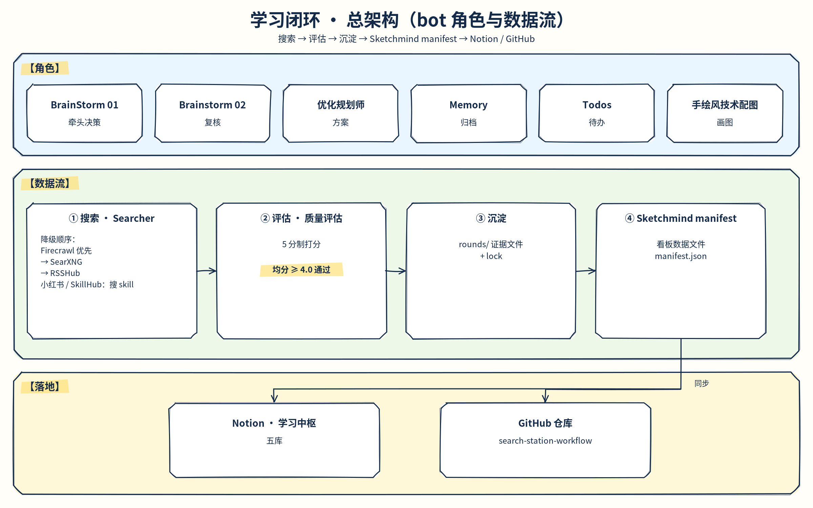
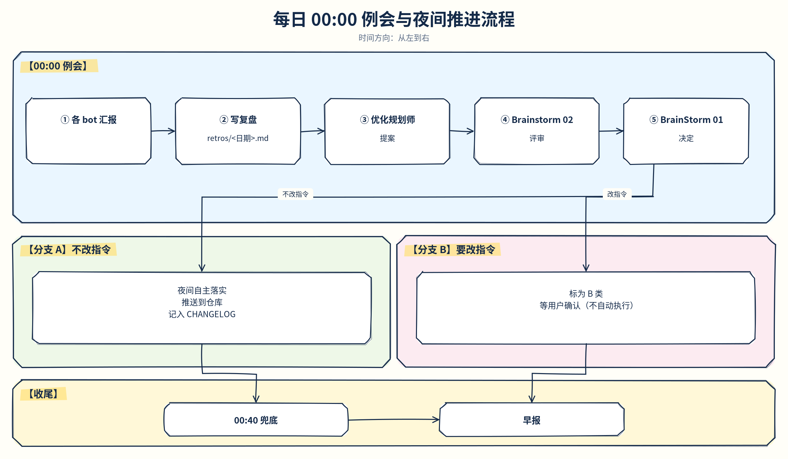

# search-station-workflow · 情报站多 bot 学习闭环工作流

> 一套由 8 个协作 bot 组成的「情报站」工作流：围绕用户发来的主题做**搜索 → 评估 → 沉淀 → 看板/知识库**，每天 00:00 例会复盘并在夜间自主推进，白天由用户拍板关键决策。
> 本仓库是可复用的工作流套件（文档、角色模板、配置示例、决策记录、架构图），目标是让别人 clone 后改一份配置、贴几份角色指令就能搭起自己的情报站。

状态：2026-10-28。当前生效指令版本为 **v3**（`bots/bot-instructions-v3.md` / `templates/bot-instructions-v3.md`，2026-10-28 19:30 Asia/Shanghai 用户确认生效）。历史草案：`templates/bot-instructions-v3-draft.md`（备查）。

## 架构总览





图的可编辑源文件：`docs/diagrams/*.excalidraw`（可导入 Excalidraw）、`*.svg`，生成脚本 `docs/diagrams/gen_*.py`（由「手绘风技术配图」bot 维护）。

一句话流程：
- **主循环**：用户发内容 → 当值主 bot（BrainStorm 01/02）发散关键词、发「搜索计划卡」 → Searcher 搜索并验链 → 质量评估打分 → 另一主 bot 复核 → 发排序给用户 → 用户挑选 → Memory 写 manifest 并同步 Notion。
- **复盘与自进化**：每日 00:00 例会 → retros/<日期>.md → 优化规划师出方案 → Brainstorm 02 评审 → BrainStorm 01 拍板 → 不改指令的改动夜间自主落实；改指令的标「B 类 / 待你决定」等用户确认。

## 快速开始

1. 读 [`docs/setup-from-scratch.md`](docs/setup-from-scratch.md)，按步骤在新账号建 8 个 bot。
2. 把 `templates/bots/<role>.md` 的指令粘到对应 bot（再把占位符换成你的实际值）。
3. 复制 `config/station.yaml.example` → `config/station.yaml`，并复制 `config/.env.example`，只在本地填真实值（`.env` 不进仓库）。（旧名 `config.example.yaml` 仅为兼容指针。）
4. 连接 Notion 并建五库（schema 见 setup 文档）；部署 SearXNG 与 RSSHub；登录 Firecrawl CLI。
5. 每个 bot 建好 00:00 例会 / 00:40 兜底定时任务。
6. 用 `templates/evidence/` 的模板跑第一轮搜索。

## 目录

```
README.md / CHANGELOG.md / LICENSE / NOTICE
搭建总说明.md                 早期（v1）说明，保留
schemas/                      JSON Schema：manifest / plan / search / eval / retro / daily-report / decision-record
adapters/
  search/                     搜索后端 stub（firecrawl、searxng、…）
  storage/                    镜像 stub（notion、local-md、obsidian、none）
  tasks/                      任务库 stub（notion、local-sqlite；不走 manifest）
  platform/                   平台 stub（grok-bot）
config/
  station.yaml.example        集中配置真源（推荐）
  config.example.yaml         兼容指针 → station.yaml.example
  .env.example / backends.yaml / searxng-settings.example.yml
templates/
  bots/<role>.md              8 角色通用指令模板
  bot-instructions-v3.md      现行 v3 全文（占位符）
  bot-instructions-v3-draft.md  v3 草案（已生效，备查）
  evidence/ / retro.md / daily-report.md / decision-record.md
docs/
  workflow.md / setup-from-scratch.md / skills-and-tools.md
  self-evolution.md / extensibility.md / design-tradeoffs.md
  decisions/                  决策记录（含 user-decisions-20261028/01-final-1928.md）
  diagrams/
bots/
  bot-instructions-v3.md      现行 v3（脱敏）
  bot-instructions-v2.1.md    历史
  _instance/                  实例专属（仅 README 入库；真 UUID 本机保留、gitignore）
  sites-to-login.md
scripts/validate-schemas.py
retros/ / rounds/ / skills/ / sketchmind-template/ / decisions/
```

## 实例信息与开源注意

- 看板示例：https://123sssdd.github.io/Sketchmind/ （数据只来自仓库根目录 `manifest.json`）。
- 公开树指令已脱敏：`bots/bot-instructions-v3.md`、`templates/` 使用 `<AGENT_ID_*>`、`<NOTION_HUB_URL>`、`<NOTION_TODOS_DB_URL>`；真实 id 仅留本机 `bots/_instance/`（gitignore，不推送）。
- 仓库中不含任何密钥、token、cookie；配置只写环境变量名。
- 延后项（用户 2026-10-28 19:28）：Tavily 暂不申请；B站字幕暂不处理；RSSHub 本实例保持监听所有网卡（不改 localhost-only）。运行时服务本轮未改。


## 许可

[PolyForm Noncommercial License 1.0.0](https://polyformproject.org/licenses/noncommercial/1.0.0)（见 `LICENSE` / `NOTICE`）。

允许开源使用、研究与非商业分发；**不允许商业使用**。详见许可证全文。
